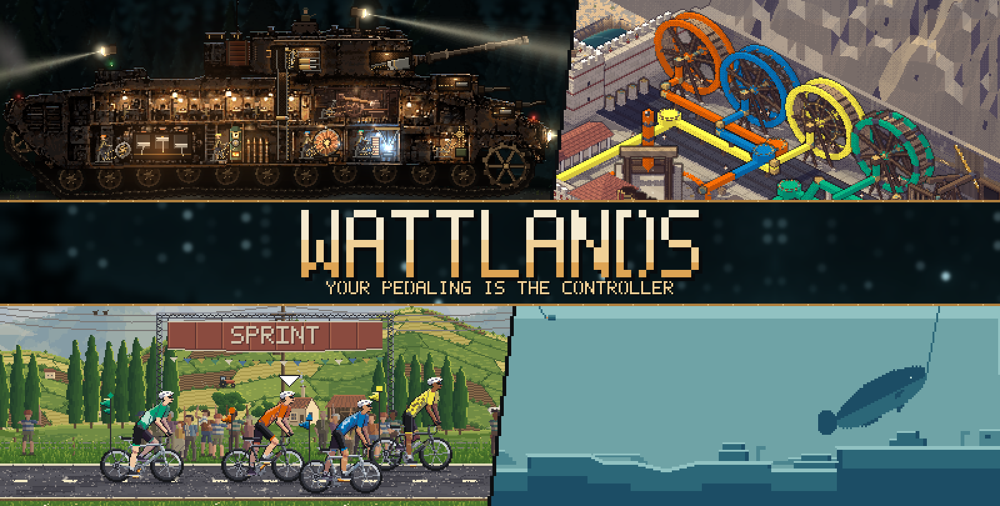
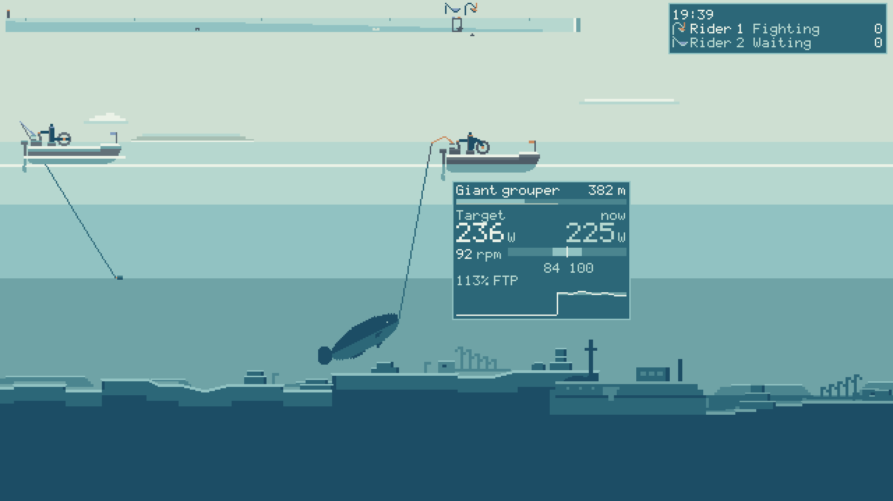
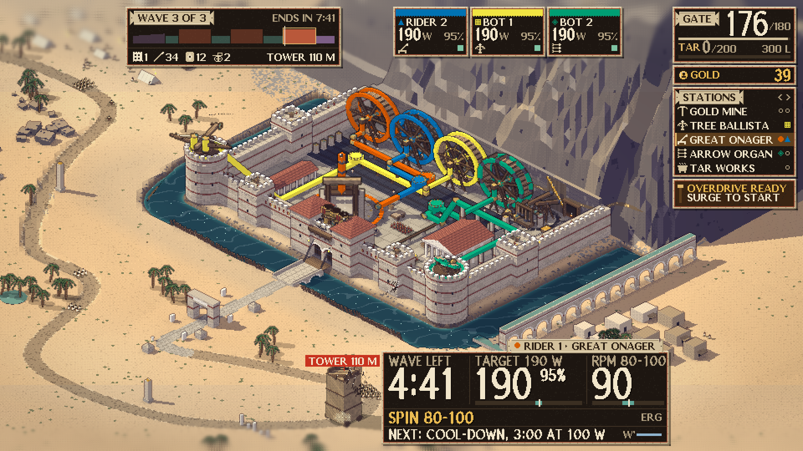
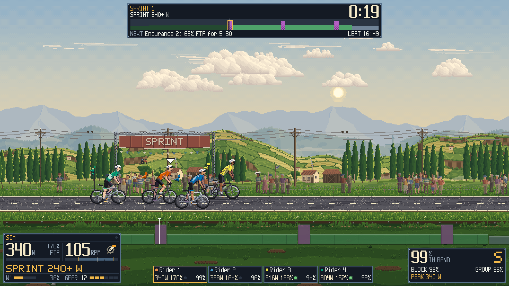

**WATTLANDS is a multiplayer fitness party game for the Wahoo KICKR CORE and KICKR CORE 2.** Your pedaling is the controller and the trainer pushes back. One app holds four games. A host shares a short room code and friends join with it; there are no accounts. Every ride is saved as a FIT file and can go to your own Strava account. Windows 10/11.

> **Status:** built and tested with mock trainers only, without a real KICKR and without the real Strava API. No person has listened to the sound yet. Follow [the hardware test plan](docs/HARDWARE_TEST_PLAN.md) and each game's `HARDWARE_TEST.md` before riding hard on it.

| Game | Riders | What it is |
| --- | --- | --- |
| [**Turbo Reel**](#turbo-reel) | 1-4 | Sport fishing on one shared ocean. Pedal your boat out, cast at the fish you see, fight them on the trainer. The first-run game. |
| [**Castellum Rotae**](#castellum-rotae) | 1-4 | Co-op tower defense at a Roman wheel fort. Your watts turn a great treadwheel that drives a mine or a siege weapon. |
| [**Workout**](#workout) | 1-8 | Group interval rides on a country road: sprints, a rolling road and `.zwo` import. |
| [**Diesel Domestiques**](#diesel-domestiques) | 1-4 | Crew a pedal-powered landship at night. Six seats, three difficulty levels, a 15-minute Ambush. |

Bots can fill the empty places in every game.

## Quick start

1. Download the latest Windows zip from the [releases](https://github.com/shoedler/wattlands/releases), unzip the whole folder and run `Wattlands.exe` (Windows 10/11, x86_64).
2. Update the trainer's firmware with the Wahoo app, then close every other app that might connect to it (Zwift, the Wahoo app).
3. Pedal. With no input at all, 20 seconds of pedaling on the title screen creates a profile and starts a ride. Every game plays to the end with no input. For menus, use the keyboard or a controller, or switch on Settings > Pedal navigation (off by default): the focus then moves every 1.6 s, a short surge picks, coasting for 3 s goes back (outside ERG), and a small graph shows how hard to surge.
4. Set your FTP in the profile, or run the FTP test in Settings. Until it is verified, every ERG target is lowered by 15%.
5. Optional: connect a Bluetooth heart rate sensor in Settings > Trainer > Sensors. Your heart rate shows next to your power, goes into the FIT file and the results, and is never shared with other riders.

Stop pedaling for 5 seconds and your ride pauses.

**No trainer, or a play test?** `--mock-trainer` (or Settings > Trainer > Use the mock trainer) rides a simulated rider. Add `--mock-keyboard` (or the "Keyboard controls the mock trainer" toggle) to steer it: T/G power, Y/H cadence, M , . J K L U I O set 50 to 250 % of FTP, N stops, Shift sprints ([docs/TRAINER.md](docs/TRAINER.md)).

## The games

### Turbo Reel



Drive out from the harbour across the shallows, the reef, the shelf and the deep. Ease off and the boat drifts to a stop. Cast at a fish you can see and the fight starts.

- In a fight, the trainer holds the fish's pull in ERG and your cadence is the skill. Too slow and the line snaps. Too fast and the hook comes out. In the band, the fish tires.
- At the boat, a 30 s landing in simulation mode holds a 15 s sprint with the gaff.
- Bigger fish live farther out and fight harder.
- **Free Roam** is competitive: most points in 10 to 60 minutes wins, and bots can take the empty boats. **Workouts** keep a plan and score together.

### Castellum Rotae



Each rider turns one great treadwheel. Couple yours to the gold mine, the tree ballista, the great onager, the arrow organ or the tar works. Attackers march down one long road to the only gate.

- Waves are ERG intervals. Breaks are recovery and shopping.
- Overdrive is a 30 s sprint in simulation mode that doubles your output while you hold your FTP.
- Sessions run from 31 to 55 minutes. Bots can turn the empty wheels.

### Workout



Everyone rides the same timeline at their own % of FTP, in one morning on a country road that goes from the blue hour to full day.

- Sessions of 28 to 40 minutes: an easy ride with three sprints, sweet spot, threshold, VO2 and a rolling road in simulation mode.
- Put your own `.zwo` files in the `workouts/` folder of your profile and pick them in the lobby.
- A crowd and a gantry come out for scored sprints.

### Diesel Domestiques


One to four riders crew a pedal-powered landship through a starry forest night. The enemy stands 800 to 2400 m off, so the screen splits: your tank and the near road on one side, a long-lens view of the enemy on the other.

- **Six seats:** Drive, Gun, Loader, Lights, Secondaries and Repairs. Each one is a machine with its own load, in ERG or simulation mode. Move to any empty seat at any time and your trainer follows.
- **Shells fly for 1.4 to 4 s.** An incoming shell is the cue to sprint: hold the sprint and a telegraphed shot misses. There is no button for it.
- **Difficulty:** Easy, Normal or Hard, set by the host. It changes the enemies and the repair rate, never your effort or your plan.
- **Ambush** is a 15-minute session with about 7 minutes of hard fights. It defaults to Hard, so expect to lose the tank once or twice. The ride goes on either way. **Ashfall Road** is about 30 minutes, and free roam runs from 10 to 60.
- **Bots** can fill a crew up to four. They load, repair and cover a rider who stopped, and a human's move always wins.

## What you get

**Your pedaling is the controller.** Power and cadence play every game. If you never touch a button, Autopilot makes the choices and you just ride.

**The trainer pushes back.** Games use ERG for steady work and simulation mode for sprints and terrain. A fish's pull, a gun's capacitor bank or a boiler's pressure changes the load inside limits.

**Riders of different strength ride together.** Targets are set in % of each rider's own FTP.

**Multiplayer with no accounts.** Up to four riders in Turbo Reel, Castellum Rotae and Diesel Domestiques, and eight in Workout, over a small relay you can run yourself. A rider who drops can rejoin within two minutes. Bots fill out a solo ride or a small group.

**Your rides are yours.** Every ride is saved as a FIT file in your profile's `rides/` folder. Uploading to your own Strava account is optional and uses your own API application.

**Art and sound come from this repository.** No game calls an image or audio service, and there are no sample packs.

- The art is baked by scripts and code in the repository. The one exception to "drawn from code" is Diesel Domestiques' landship and forest, which scripts rebuild as pixel art from a reference image made for this project and kept in the repository.
- The sound is rendered from recipes in the repository by `tools/audio`: a diesel with three unequal cylinders, a treadwheel's pawl and creak, a chain and a freewheel, a boat's engine, a night forest. Nobody has heard it yet.
- Each rider's machine runs on that rider's cadence, in picture and sound: legs and cranks in Workout, the walkers in a treadwheel, a boat's crank, the landship's pistons and rivet hammer. Stop pedaling and the strokes stop. Wheels and tracks follow speed and distance, and a treadwheel itself turns by watts.
- The trainer reports cadence about once a second, not crank angle. So the sound locks exactly to the crank on screen, and to your feet in rate only.

## Safety

Every load change, in every game, goes through one safety governor on your own PC. Other riders' PCs can only make requests; yours checks and limits them. Here is what it does for you.

- **Ramps.** Load rises by at most 30 W per second and drops at once. The one exception is a short haptic pull, such as a big fish's 2 s surge, and Settings > Haptics turns those off. Every switch between ERG and simulation mode is ramped and starts from what you are actually riding.
- **Warm-up limits.** For the first 5 minutes of riding, ERG stays at or under 65% of FTP, grade stays between -2% and +3%, and haptics are off. Every game opens with a warm-up. You can skip it in your profile.
- **Rescue.** In ERG at 60% of FTP or more, if your cadence falls under 45 rpm for 3 s or your power under 75% of the target for 5 s, the target drops to 50% of FTP. Once you are back at 70 rpm for 3 s, it ramps back over 10 s. Games treat this as a stumble and never end your ride for it.
- **Limits on hard efforts.** ERG never goes above 150% of FTP. It allows at most 5 minutes above 105% and 1 minute above 120%, then holds you down until you have ridden 2 minutes at 90% or less. The FTP test lifts these limits, because it ends by itself when you fade.
- **Coasting.** Stop pedaling and ERG drops to a low floor after 3 s. Then a solo ride pauses, and in a group you are marked away.
- **Panic.** Hold Backspace for 1 s, or View + Menu on a controller, and the trainer goes safe at once and stays safe until you resume. The pause menu has it too.
- **On exit, a crash or a disconnect,** the app tries to set the trainer flat and stop it.

The governor limits what the app asks of the trainer. It does not replace your own judgement. It has only run against mock trainers so far, so work through [the hardware test plan](docs/HARDWARE_TEST_PLAN.md) first.

## Playing together

Multiplayer goes through a small relay that every rider's PC can reach.

1. One PC runs the relay: `node server/relay/src/main.ts` from this repository (port 8787), or `docker build -t wattlands-relay server/relay` and `docker run -p 8787:8787 wattlands-relay`. Allow port 8787 through the firewall.
2. Every rider sets Settings > Network > Relay URL to `ws://<relay PC's address>:8787/v1`. A build exported with `--relay-url=<url>` has that relay as its default, so its riders change nothing.
3. The host picks a game, chooses Host and reads out the room code; friends choose Join and type it. A rider who drops can rejoin with the same code within two minutes.

Friends in another place: the relay must be reachable from their PC. The simplest way is Tailscale: share only the relay PC with your friend (they use their own Tailscale account) and use its Tailscale address (`tailscale ip -4`) in the Relay URL. A hosted relay works too ([fly.toml](server/relay/fly.toml), [render.yaml](server/relay/render.yaml), then `wss://<host>/v1`). Everyone must run the same release.

## Controls

| Action | Keyboard | Xbox controller |
| --- | --- | --- |
| Move | Arrows or WASD | Left stick or D-pad |
| Confirm / Back | Enter or Space / Esc | A / B |
| Ability 1 / 2, Item, Swap | 1 / 2, F, R | X / Y, RB, LB |
| Virtual gears down / up | Q / E | LT / RT |
| Pause | P | Start |
| Panic (trainer to safe at once) | Hold Backspace 1 s | View + Menu |
| Help (what is on the screen) | F1 | Left stick click |
| Fullscreen on / off | F11 or Alt+Enter | |

Bindings can be changed in Settings > Controls (fullscreen also in Settings > Audio and display). Zwift Click or Play buttons can be mapped to these keys with BikeControl.

## Strava

Uploads use your own Strava API application: create one at https://www.strava.com/settings/api (callback domain `localhost`), enter its Client ID and Secret in Settings > Strava and choose Connect. Then upload from the results screen or turn on auto-upload. This has not yet run against the real Strava API.

## Troubleshooting

- "Another app may hold control": close Zwift, the Wahoo app and any other trainer app, then reconnect.
- The trainer won't connect: remove any Windows-level Bluetooth pairing of it, keep it close, and update its firmware (WATTLANDS needs FTMS).
- No Bluetooth trainers at all on a fresh PC: install the Microsoft Visual C++ 2015-2022 x64 runtime (https://aka.ms/vs/17/release/vc_redist.x64.exe).
- Host fails or friends can't join: check that the relay runs and that every Relay URL points at it.

## Developing

WATTLANDS is built in Godot 4.7.2. Run it only through `tools/godot.sh` (or `tools/godot.ps1`), which sets the hardware and network locks.

```bash
tools/godot.sh --path . -- --mock-trainer=erg   # run the app with a mock trainer
tools/run_tests                                 # run the full test suite
node tools/export_windows.mjs --smoke           # build build/windows/
```

The export needs a standard Godot 4.7.2 editor and its export templates ([docs/deps.d/godot.md](docs/deps.d/godot.md)). A new game starts with `tools/new_game <id>`.

- [docs/ARCHITECTURE.md](docs/ARCHITECTURE.md): the layers
- [docs/GAME_SDK.md](docs/GAME_SDK.md): the contract a game implements
- [docs/AUDIO_PIPELINE.md](docs/AUDIO_PIPELINE.md): how sound is rendered from recipes
- [docs/ART_PIPELINE.md](docs/ART_PIPELINE.md): how 2D art is made
- [CHANGELOG.md](CHANGELOG.md): what changed in each release

The images in this README are real frames from the game; `assets/readme/render_frames.sh` and `compose.mjs` rebuild them.

## License

MIT, see [LICENSE](LICENSE). Third-party code and assets are listed in [CREDITS.md](CREDITS.md), [docs/DEPENDENCIES.md](docs/DEPENDENCIES.md) and [docs/THIRD_PARTY_NOTICES.txt](docs/THIRD_PARTY_NOTICES.txt).
