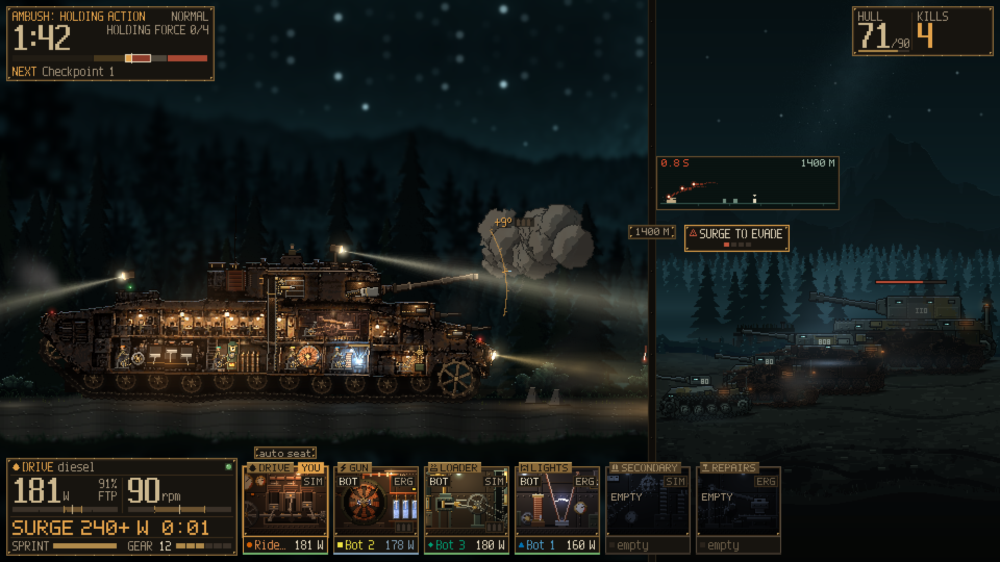

# Wattlands

Party games for your smart trainer. You pedal, the game reacts, and the trainer pushes back: a fish pulls on the line, a shell forces a sprint, a wave of attackers becomes an interval. It runs on Windows 10/11 with a Wahoo KICKR CORE or KICKR CORE 2.

There are four games in one app. Someone hosts, reads out a room code, and friends join with it. No accounts. Riders of different strength can share a session because every target is a percentage of your own FTP, and the host can add bots to fill the empty seats.

| | Riders | |
| --- | --- | --- |
| [Turbo Reel](#turbo-reel) | 1-4 | Sport fishing on a shared ocean |
| [Castellum Rotae](#castellum-rotae) | 1-4 | Co-op tower defense, powered by treadwheels |
| [Workout](#workout) | 1-8 | Group intervals on a country road |
| [Torque Company](#torque-company) | 1-4 | Crew a pedal-powered landship at night |

## Getting started

Grab the Windows zip from the [releases page](https://github.com/shoedler/wattlands/releases), unzip the whole folder and run `Wattlands.exe`. Close Zwift, the Wahoo app and anything else that might hold the trainer, and make sure its firmware is current.

Then pedal. Twenty seconds of pedaling on the title screen creates a profile and starts a ride, and every game can play through to the end without you touching anything. Set your FTP in the profile or run the FTP test in Settings. Until it's verified, ERG targets are 15% lower.

If you'd rather stay on the bike with no keyboard in reach, turn on Settings > Pedal navigation. The focus moves by itself, a short surge picks, and coasting for 3 s goes back, except during an ERG phase.

Stop pedaling for 10 seconds and a solo ride pauses until you pedal again. In a group you're marked away, and the game only stops once every rider has. Bad day? The ride menu (Esc or P) can discard a ride so nothing from it is kept. It asks first, and Yes needs the keyboard or a controller, so a sprint can't throw your ride away by accident. If you're hosting, that ends the session for everyone, though the others keep their rides.

You can pair a Bluetooth heart rate strap in Settings > Trainer > Sensors. It shows next to your power and goes in your FIT file, and other riders never see it.

No trainer handy? Run `Wattlands.exe -- --mock-trainer` (or use Settings > Trainer > Use the mock trainer) to ride a simulated rider, and add `--mock-keyboard` to steer it. [docs/TRAINER.md](docs/TRAINER.md) has the keys.

## The games

### Turbo Reel


Pedal your boat out of the harbour, past the shallows and the reef to the deep water where the big fish live. Cast at a fish you can see and the fight starts.

The trainer holds the fish's pull in ERG, and your cadence does the work. Spin too slowly and the line snaps, too fast and the hook comes out. Stay in the band and the fish tires. Get it to the boat and you have 15 s to sprint for the gaff. Fill the meter and it's a Trophy, worth half as much again.

Free Roam is a race for points over 10 to 60 minutes. Workouts follow a plan and everyone scores together.

### Castellum Rotae


A Roman fort has one gate and one road leading to it, and attackers are coming down that road. Each rider turns a great treadwheel and couples it to the gold mine, the tree ballista, the great onager, the arrow organ or the tar works.

Waves are ERG intervals and the breaks between them are for recovering and shopping. Overdrive is a 30 s sprint that doubles your output as long as you hold your FTP. A session takes 31 to 55 minutes.

### Workout


The plain one, and the one for up to eight. Everyone rides the same timeline at their own percentage of FTP, on a country road that goes from the blue hour to full daylight over the session. A crowd and a gantry turn out for scored sprints.

Sessions run 28 to 40 minutes: an easy ride with three sprints, sweet spot, threshold, VO2 and a rolling road. To ride your own, drop `.zwo` files in `%APPDATA%Godotapp_userdataWATTLANDSworkouts` and pick them under Ride in the lobby, which shows the path too.

### Torque Company



Up to four riders crew a landship through a starry forest night. The enemy stands 800 to 2400 m away, so the screen splits: your tank and the road on one side, a long-lens view of the enemy's armour on the other.

There are six seats (Drive, Gun, Loader, Lights, Secondaries, Repairs), and each one is a machine with its own feel on the trainer. Change seats whenever one is free or held by a bot and your load follows you, though a move between ERG and SIM can wait for the 30 s gap between mode switches. A plain shot gives you the 1.4 to 4 s of its flight. A telegraphed one glows first, so you get at least 6 s even on Hard, and if you're on a SIM seat (Drive, Loader, Secondaries), holding a sprint for 2 s makes it miss, 3 s against the Behemoth. There's no button for it.

The host picks Easy, Normal or Hard, which changes the enemy and the repair rate. It never changes your effort plan or its limits, though a longer fight on Hard can hold your target higher for longer. Ambush is about 15 minutes with about 6 of hard fighting, and on its default Hard you should expect to lose the tank once or twice. The ride carries on regardless. Ashfall Road takes 30 to 41 minutes, and free roam 10 to 60.

## Riding safely

Everything that changes the load goes through one safety governor on your own PC. Other riders' machines can only ask, and yours decides. These are the limits it holds in every game:

| | |
| --- | --- |
| Ramps | In ERG the target rises by at most 30 W per second and drops at once, and short haptic pulls are the one exception. In SIM the load follows the grade, and haptics add at most +3% for at most 8 s. Settings > Haptics turns all haptics off. |
| Warm-up | For your first 5 minutes of riding, ERG stays at or under 65% of FTP, grade between -2% and +3%, and haptics are off. You can skip this in your profile. |
| Rescue | In ERG at 60% of FTP or more, if cadence falls under 45 rpm for 3 s or power under 75% of target for 5 s, the target drops to 50% of FTP. Back at 70 rpm for 3 s and it ramps up again over 10 s. A game never ends your ride for this. |
| Hard efforts | ERG tops out at 150% of FTP, with at most 5 minutes above 105% and 1 minute above 120%. After that it holds you down until you've ridden 2 minutes at 90% or less. The FTP test lifts these limits, since it ends when you fade. |
| Coasting | ERG drops to a low floor after 3 s. After 10 s a solo ride pauses, and in a group you're marked away. |
| Panic | Hold Backspace for 1 s, or View + Menu on a controller. The trainer goes safe at once and stays safe until you resume. |
| Exit or crash | The app tries to set the trainer flat and stop it. |

None of this replaces your own judgement. If something feels wrong, stop pedaling.

## Playing together

Multiplayer needs a small relay that every rider's PC can reach. One of you runs it from this repository, with Node 22.18 or newer:

```bash
node server/relay/src/main.ts
```

It listens on port 8787, so allow that through your firewall. There's a Dockerfile too, and [fly.toml](server/relay/fly.toml) and [render.yaml](server/relay/render.yaml) if you'd rather host it.

Everyone then sets Settings > Network > Relay to `ws://<relay address>:8787/v1` (`wss://<host>/v1` for a hosted one). The host picks a game and reads out the room code, the others choose Join and type it. If you drop out you have two minutes to rejoin with the same code. Everyone needs to be on the same release.

For friends elsewhere, Tailscale is the easy way: share just the relay PC with them and use its Tailscale address as the Relay.

## Controls

| | Keyboard | Xbox controller |
| --- | --- | --- |
| Move | Arrows or WASD | Left stick or D-pad |
| Confirm / Back | Enter or Space / Esc | A / B |
| Ability 1 / 2, Item, Swap | 1 / 2, F, R | X / Y, RB, LB |
| Virtual gears down / up | Q / E | LT / RT |
| Pause | P | Menu |
| Panic | Hold Backspace 1 s | View + Menu |
| Help | F1 | Left stick click |
| Fullscreen | F11 or Alt+Enter | |

Rebind them in Settings > Controls. Zwift Click and Play buttons can map to these keys through BikeControl.

## Your rides and Strava

Every ride is saved as a FIT file in `%APPDATA%Godotapp_userdataWATTLANDS
ides`. To upload to Strava, create your own API application at https://www.strava.com/settings/api with the callback domain `localhost`, enter its Client ID and Secret in Settings > Strava, and choose Connect. Then upload from the results screen or turn on auto-upload.

## If something doesn't work

"Another app may hold control" means just that: close Zwift, the Wahoo app and any other trainer app, then reconnect.

If the trainer won't connect, remove any Windows Bluetooth pairing of it, keep it close and update its firmware. Wattlands talks to it over FTMS.

On a fresh PC with no Bluetooth trainers showing at all, install the [Visual C++ x64 runtime](https://aka.ms/vs/17/release/vc_redist.x64.exe).

If hosting fails or friends can't join, check the relay is running and that everyone's Relay setting points at it.

## Hacking on it

The game is written in Godot 4.7.2 and GDScript. Art and sound are generated from code and recipes in this repository, with no sample packs and no image or audio service at runtime. The one starting point that isn't code is the reference image behind Torque Company's landship and forest, made from a prompt, which scripts rebuild as pixel art. Turbo Reel's style follows a pixel-art guide image, and nothing from it ships. An early image-model attempt at Turbo Reel's sprites was thrown out, and no shipped art comes from one.

Always run Godot through `tools/godot.sh` or `tools/godot.ps1`. They set the locks that keep automated runs from commanding a real trainer.

```bash
tools/godot.sh --path . -- --mock-trainer=erg   # run with a mock trainer
tools/run_tests                                 # full test suite
node tools/export_windows.mjs --smoke           # build build/windows/
```

Exporting needs a standard Godot 4.7.2 editor and its templates ([docs/deps.d/godot.md](docs/deps.d/godot.md)). `tools/new_game <id>` starts a new game. To find your way around, read [ARCHITECTURE](docs/ARCHITECTURE.md), the [Game SDK](docs/GAME_SDK.md), the [audio](docs/AUDIO_PIPELINE.md) and [art](docs/ART_PIPELINE.md) pipelines, and the [hardware test plan](docs/HARDWARE_TEST_PLAN.md). What changed and when is in the [changelog](CHANGELOG.md).

## License

MIT, see [LICENSE](LICENSE). Third-party code and assets are listed in [CREDITS.md](CREDITS.md), [docs/DEPENDENCIES.md](docs/DEPENDENCIES.md) and [docs/THIRD_PARTY_NOTICES.txt](docs/THIRD_PARTY_NOTICES.txt).
