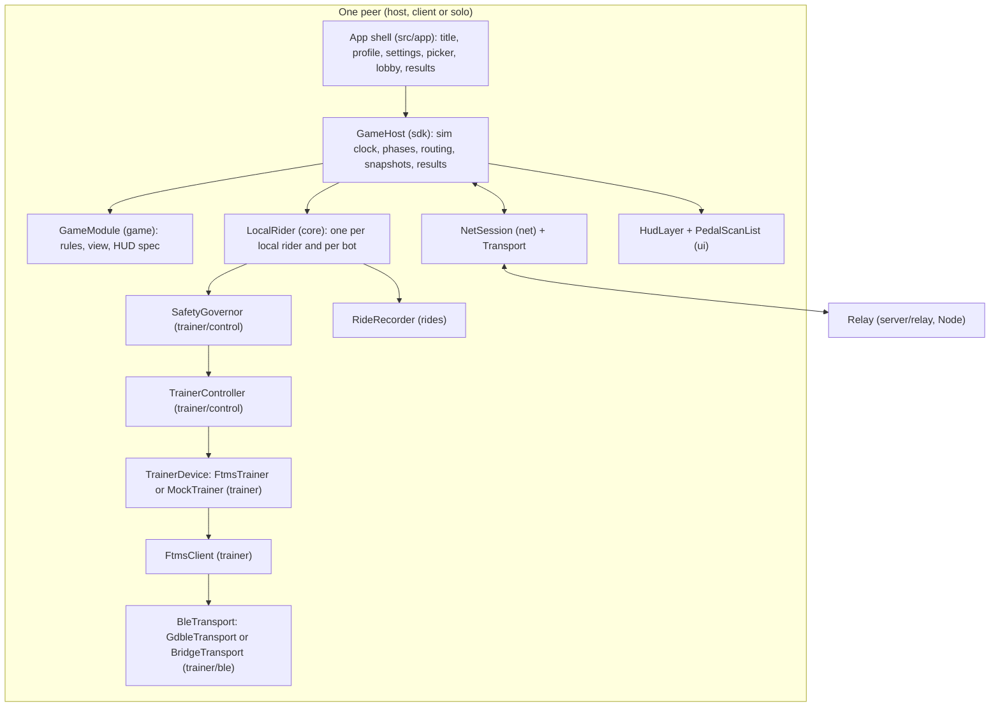

# WATTLANDS architecture

WATTLANDS is one Godot 4.7 project (GDScript, Compatibility renderer) that hosts several games. The platform lives in `addons/wattlands/`, the app shell in `src/app/`, games in `src/games/<id>/`, and the Node services in `server/` and `tools/`. "BRIEF x.y" refers to `docs/BRIEF.md`.

## Layers

Telemetry flows up as `TrainerSample {t, power_w, cadence_rpm?, speed_kmh?, flags}` (BRIEF 4.1). Commands flow down only through the governor: only `SafetyGovernor` holds `TrainerController`, only `TrainerController` calls `TrainerDevice` setters, only `FtmsTrainer` calls `FtmsClient.write_control()` (BRIEF 4.6.11, enforced by `tests/arch/test_no_bypass.gd`).

## Autoloads

Autoload names never change. Each is an instance of a class named `Wl<Name>` (a script class can't share an autoload's name), so tests and in-process simulations can create private instances.

| Autoload | Class | File |
| --- | --- | --- |
| `EventBus` | `WlEventBus` | `addons/wattlands/contracts/event_bus.gd` |
| `Settings` | `WlSettings` | `addons/wattlands/core/settings.gd` |
| `InputRouter` | `WlInputRouter` | `addons/wattlands/ui/input_router.gd` |
| `TrainerService` | `WlTrainerService` | `addons/wattlands/core/trainer_service.gd` |
| `NetSession` | `WlNetSession` | `addons/wattlands/net/net_session.gd` |
| `GameRegistry` | `WlGameRegistry` | `addons/wattlands/sdk/game_registry.gd` |
| `Rides` | `WlRides` | `addons/wattlands/rides/rides_service.gd` |
| `Sfx` | `WlSfx` | `addons/wattlands/audio/sfx.gd` |
| `App` | `WlApp` | `addons/wattlands/core/app_state.gd` |

## Contracts (frozen)

`addons/wattlands/contracts/` holds the SDK and cross-module types: `Wl` (constants, slot looks, rule names), `GameModule`, `GameContext`, `PlayerSlot`, `EffortPlan`, `PlanPhase`, `PhaseState`, `EffortDirective`, `DirectiveResult`, `DirectiveSink`, `InputFrame`, `Telemetry`, `HudSpec`, `HudFeed`, `IntentSink`, `ProgressStore`, `GameStrings`, `GameResults`, `SessionStats`, `TrainerSample`, `TrainerDevice`, `BleTransport`, `Transport`, `NetMessages`, `RideRecorderApi` and `WlEventBus`.

These module classes are called by other modules, so their public signatures are frozen (additive changes only): `SafetyGovernor`, `MockTrainer`, `FtmsClient`, `FtmsTrainer`, `FtmsConnectionManager`, `GestureRecognizer`, `SprintRule`, `ZwoImport`, `Bots`, `LocalRider`, `WlSettings`, `WlApp`, `WlTrainerService`, `WlNetSession`, `Protocol`, `LoopbackTransport`, `RoomCode`, `WlGameRegistry`, `PlanValidator`, `GameHost`, `GameSimRunner`, `WlInputRouter`, `PedalScanList`, `HudLayer`, `PixelViewport`, `WlSfx` and `WlRides`. The shared pure logic is plain tested code: `SimClock`, `SeededRng`, `WBalance`, `EffortScaling`, `SpeedModel`, `GovernorClamps`, `Paths`, `CmdLine`, `RiderProfile`, `RoomCode`, `Bots` and `MockTrainer`.

## Time

Everything advances in fixed 0.05 s steps (`Wl.SIM_DT`) on a `SimClock`. Two times run side by side:

- Platform time always runs. The trainer stack, the governor's time rules (slew, rescue, coasting, warm-up, duration limits), MockTrainer's rider model and its ~1 Hz notifications, telemetry and the recorder use it.
- Game time stops while the session is paused (BRIEF 4.1). `sim_step`, phase elapsed time and directive expiry use it.

Nothing reads the wall clock except the real-time driver (`SimClock.advance(delta)` in `_process`, which yields `sim_speed` steps per 0.05 s of wall time) and the UTC stamp of a ride. Headless simulations call `step()` in a loop, so a 40-minute session runs in seconds and every run with the same seed gives the same report. `--sim-speed` never touches `Engine.time_scale`.

## The per-rider stack: LocalRider

`LocalRider` (core) composes one rider's stack on this machine: `TrainerDevice` -> `SafetyGovernor` (which owns the `TrainerController`), `GestureRecognizer`, `WBalance`, `SpeedModel`, `EffortScaling`, the `RideRecorder` and telemetry. Each tick: `device.tick(dt)` emits samples; samples feed gestures, W' balance, the governor (rescue, coasting, warm-up, 3 s power) and the recorder (1 Hz); the speed model integrates P_eff on the applied grade; `governor.tick(dt)` applies the rules and commands the controller (which coalesces to at most 2 writes per second and ramps mode switches). There is one LocalRider per local human rider and one per bot (bots ride `MockTrainer` `erg:compliance=1.0+band`, `Bots.RIDER_SPEC`, on the host, with no recorder).

Every rider's governor is local to the machine that owns the rider's trainer. The network never sends device commands (BRIEF 4.6.7).

## Sessions: GameHost on every peer

A `GameHost` (sdk) owns one session on one peer, in one of three roles.

- SOLO: no network. The GameHost ticks its LocalRiders (the player and any bots), builds the `InputFrame`, calls `sim_step`, tracks phases and records the ride.
- HOST: like SOLO, plus remote riders. Remote telemetry arrives at 5 Hz through NetSession; the host sends `plan` and `phase` to each client, `directive` messages for remote riders, `snapshot` at 10 Hz, `roster` at 2 Hz, batched `event`s, and `results`.
- CLIENT: no game simulation. The GameHost ticks the client's own LocalRider, applies `plan`, `phase` and `directive` messages to it (its governor re-validates and clamps them and reports what it applied in `Telemetry.acks`), sends telemetry (gestures, intents, acks) at 5 Hz, applies snapshots and events to the GameModule, and calls `client_predict`.

Phases: the host tracks every rider's plan itself (fixed durations, `max_s`, `end_phase`, `finished` -> skip to the cool-down) and emits `EventBus.phase_started(peer, index)` plus a `phase` message to that rider's client. The cool-down (180 s at 50% FTP) is appended by the `PlanValidator`; during it the GameHost keeps calling `sim_step` with kind COOLDOWN and ignores directives. The GameHost never emits `GameModule.phase_changed`; games may.

Directive flow: `ctx.directives` is the host's `DirectiveSink`. It checks each request against the rider's plan and current phase (range_pct, SIM-block length and spacing, mode_grade only in SIM, haptics never to ERG riders, nothing in the cool-down), assigns an id, and routes it: a local rider's `LocalRider.apply_directive()` directly, a remote rider's through a `directive` message. The rider's governor clamps it and reports an applied record (`EventBus.directive_applied`). The run_game_sim report keeps every directive as requested and as applied.

HUD flow: `ctx.hud` on the host routes `power_band` to the rider's peer as a `directive` of kind `power_band`, `teammate_status` into the roster, and `toast`/`banner` with a `peer` to that peer only (`hud` message); on a client it draws locally. The `HudLayer` reads the session's `WlEventBus` (bands, roster, toasts, banners, rescue, phases) and per-tick `update()` calls for the local rider.

Intents: `local_intents(actions, gestures)` runs on every peer each tick (gestures arrive apart from actions, so games can tag gesture-made intents); a game's own widgets call `ctx.intents.send()`. Clients batch intents into `Telemetry.intents` at 5 Hz; in HOST and SOLO they go straight into the local rider's `frame.players[peer].intents`. For bots and Autopilot riders the host merges `autopilot_intents(peer)` in.

Bots, AFK and reconnects: a dropped peer gets `on_afk(peer, true)` at once and `frame.players[peer]` becomes `connected = false`, power and cadence 0 and `age_s`; the slot stays. A rejoin with the relay reconnect token gets `lobby_state`, its `plan`, its `phase` and the latest snapshot; `on_afk(peer, false)` follows once fresh telemetry shows pedaling. Joins without a token after the start are refused with `session_in_progress`.

## In-process simulation

`GameSimRunner` (sdk) runs whole sessions headless for `tools/run_game_sim`, the SDK conformance test, Workout's simulation tests and `tools/screenshot`. One human slot runs SOLO; two or more run as HOST plus LoopbackTransport clients, each with its own `WlNetSession`, `WlEventBus`, `GameHost` and `LocalRider` with a `MockTrainer`. Bots are added after the humans on the host. The runner steps every peer in a fixed order per platform tick, so runs are deterministic.

## Scripted peers (end-to-end test contract)

The app runs as a scripted peer when started with `--host` or `--join=<code>` (headless or windowed). The app shell (`src/app/`) implements it; `tools/e2e/run.mjs` (qa) drives it. Both sides follow exactly this contract:

- Flags (after `--`): `--host` or `--join=<code>`; `--game=<id>`, `--content=<id>` (host; default the game's `e2e_content` when `--e2e` is given, else `default_content`); `--wait-peers=<n>` (host: start once n human peers including itself are in the lobby and ready); `--relay=<ws url>`; `--mock-trainer=<profile>`; `--autopilot`; `--profile-dir=<abs dir>`; `--seed=<n>`; `--sim-speed=1`; `--report=<path>`; `--run-seconds=<n>` (hard stop, platform seconds); `--strava-base=<url>`, `--strava-client-id=<id>`, `--strava-client-secret=<secret>` and `--strava-auto-upload` (connect to the given Strava base with these credentials at start, through the loopback flow, and auto-upload the ride; only loopback bases are allowed while the network lock is set).
- The scripted peer skips every menu, joins or hosts through `NetSession` and the relay, sends `player_info`, readies up automatically, plays the session with Autopilot, waits for the results, saves the FIT, performs the auto-upload if configured, writes the report and quits with exit code 0. Any failure quits non-zero.
- Ownership: the app shell (`src/app/scripted/`) owns this flow. `WlApp` only reports `is_scripted()` and the parsed flags (`launch_options()`), goes to the lobby state, shuts the riders down in `quit()`, and never hosts, joins, quits at `--run-seconds` on its own or writes the report for a scripted peer. `App.goto()` emits `state_changed` synchronously, because a client's GameHost is created in the same signal chain as the `session_start` message.
- Stdout lines, one per event, for the harness: `WATTLANDS_ROOM <code>` (host, as soon as the room exists), `WATTLANDS_PEER <peer id>`, `WATTLANDS_STATE <session state>`, `WATTLANDS_DONE <reason>`.
- A client restarted with the same `--profile-dir` and `--join=<code>` reuses the saved reconnect token, gets its state back from the host, and starts a new FIT file from the rejoin.
- The report (`--report=<path>`, JSON, written on exit): `{role, peer_id, room, game_id, content_id, exit_reason, events: [{t, type, peer, ...}] (session states, phase_started per rider, game events in arrival order, results), directives: [applied records], trace: [{t, mode, applied_target_w, applied_pct, applied_grade_pct, warmup_active, clamped_by, rescue, afk}] (1 Hz, local rider), fit_paths: [...], uploads: [{state, activity_id}], desync_warnings: int, script_errors: int, final_state: {...}}`.

## Multiplayer

Star topology through the relay (`server/relay`, Node, zero-dependency fallback). The relay generates 6-character Crockford codes (`K7Q-X2M`), holds a dropped host's room for 120 s, and never looks inside `d`. Game messages (BRIEF 5.5) are listed in `addons/wattlands/contracts/net_messages.gd`; `Protocol.decode()` turns ints back into ints (including each game's `int_fields()` paths) and rejects messages that fail their schema or version. See `docs/PROTOCOL.md`.

## Rides

The `RideRecorder` records the local rider at 1 Hz with laps at `lap_marker`, at plan phases with `lap = true` and at the cool-down. The results screen saves a FIT file (pure GDScript encoder, protocol 2.0) and a JSON summary under `Paths.user_dir()/rides/`, then offers Strava upload (OAuth with a loopback callback on 127.0.0.1, multipart upload, polling, token rotation, a persistent upload queue). Tests use `server/mock_strava`; `tools/fit_check` decodes every FIT the tests write.

## Presentation

`PixelViewport` renders a 2D game's Node2D at `pixel_base` with nearest filtering and integer scaling; the HUD draws above it at native resolution. 3D games use `world3d` helpers (`LowPolyMesh`, MultiMesh scatter, a miniature camera rig, sky and ambient for Compatibility). The window's base size is 1920 x 1080 with `canvas_items` stretch, so HUD sizes are given in 1080p pixels.

## What games share

What more than one game needs lives in the platform, with no game's name in it, so a new game writes no copy. `docs/GAME_SDK.md` has the members.

| Need | Class | File | GAME_SDK |
| --- | --- | --- | --- |
| A client's moving things between snapshots | `SnapHistory` (a game's subclass names its rows) | `addons/wattlands/sdk/snap_history.gd` | 12.1 |
| The time to draw them at, behind the newest snapshot | `SnapRenderClock` (`new(min_delay)`) | `addons/wattlands/sdk/snap_render_clock.gd` | 12.1 |
| Plain-data state to and from a Dictionary | `WlRecord` | `addons/wattlands/sdk/wl_record.gd` | 12.2 |
| A host's per-peer intent limit, on game ticks | `IntentRateLimiter` | `addons/wattlands/sdk/intent_rate_limiter.gd` | 12.2 |
| Reading an intent's flags and whole numbers | `IntentValue` | `addons/wattlands/sdk/intent_value.gd` | 12.2 |
| A game's own HUD Control on the art grid | `HudArtControl` | `addons/wattlands/ui/hud/hud_art_control.gd` | 18 |
| Pixel patterns and frames in such a Control | `HudArtDraw` | `addons/wattlands/ui/hud/hud_art_draw.gd` | 18 |
| A pixel font set on its art grid | `PixelFont` | `addons/wattlands/world2d/pixel_font.gd` | 18 |
| A Bresenham line | `PixelPainter.line_pixels` | `addons/wattlands/world2d/pixel_painter.gd` | 18 |
| Sound locked to the crank | `GameAudioKit`, `CrankClock`, `FrameClockLock` | `addons/wattlands/audio/` | 18 |

These are view and tooling helpers: rules stay pure, a view only reads state, and none of them reach the trainer stack. Their tests are in `tests/sdk/`, `tests/ui/`, `tests/world/` and `tests/audio/`.

Tests share code the same way. `tests/lib/` holds what a game's suites extend: `TestGameFakes`, `TestGameSuite`, `TestGameStaticSuite`, `TestGameSessionSuite` and `TestGdLex` (GAME_SDK 19.6). `tools/lib/sim_report.mjs` holds the result helpers of Siege's and Tank's `check_sims.mjs`.

## Safety and test locks

See `CLAUDE.md` (Locks) and BRIEF 1: `WATTLANDS_NO_HW_CONTROL=1` makes `FtmsClient` refuse control, `WATTLANDS_NO_NETWORK_INTEGRATIONS=1` keeps the Strava client on loopback, and `tools/art/generate.mjs` makes real fal calls only with `FAL_KEY` and `WATTLANDS_ALLOW_ART=1`.
