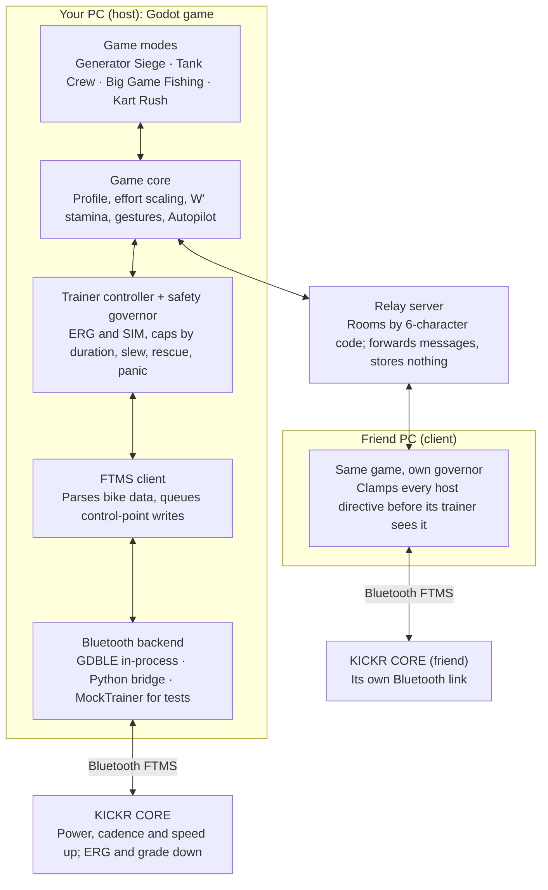

# KICKR CORE game: research and ultracode handoff

Oct 17, 2026 · Simon

> Exported on 17 Oct 2026 from the planning doc on claude.ai. In this repo the "Handoff prompt" is `docs/BRIEF.md`, and this file is a snapshot: the repo, not the doc, is now the source of truth.

Three concepts go forward: Generator Siege and Tank Crew as a co-op pair sharing one combat engine, plus Big Game Fishing for solo and endurance days; Kart Rush stays as notes. The Handoff prompt builds that trio with FIT export and Strava upload; concept art comes next, then the final cut.

## What the trainer gives you

The KICKR CORE is an input (power, cadence, speed) and an output (resistance), but its data is slow and coarse, so game mechanics should live on 2–30 second timescales.

| Fact | KICKR CORE | What it means for the game |
| --- | --- | --- |
| Power | Up to 1800 W, ±2% accuracy | Plenty of range for ERG targets and sprints; accurate enough for fair %FTP scoring |
| Simulated grade | −10% to +16% (16% assumes 79 kg rider plus bike) | Hills and resistance "haptics" are possible; clamp and scale them |
| Protocols | Bluetooth FTMS since firmware 1.1.1 (June 2021), ANT+ FE-C, up to 3 Bluetooth connections | Target FTMS only; the game can run beside the Wahoo app, but only one app controls resistance |
| Cadence | Estimated by the trainer since firmware 1.0.11 (2019); takes a few seconds to settle after a sprint | No twitchy cadence mechanics; back it up with a speed-based estimate |
| Data rate | Apps typically get FTMS bike data about once per second | Decisions every 10–30 s, not reflexes |
| ERG | Holds target power whatever your cadence; CORE 2 regulates more slowly and overshoots a little at high power | ERG for sustained phases, free simulation for sprints, ramp every target change |
| Mode switching | Firmware 1.5.5 (April 2024) fixed a 2000 W spike when switching between ERG and SIM | Require current firmware and ramp through every mode switch |
| Shifting | Zwift Click virtual shifting works only inside Zwift; CORE 2 ships with a single Zwift Cog | The game needs its own virtual gears in simulation modes |
| CORE 2 extras | Wi-Fi and Ethernet; Wahoo's Direct Connect carries the Bluetooth protocol over TCP/IP | A no-Bluetooth backend is possible later |

Sources: [Wahoo specs](https://support.wahoofitness.com/hc/en-us/articles/360000456959), [Wahoo store specs](https://nordic.wahoofitness.com/products/wahoo-kickr-core), [79 kg note](https://www.sigmasports.com/item/Wahoo/KICKR-CORE-Smart-Turbo-Trainer/J8SP), [firmware notes](https://support.wahoofitness.com/hc/en-us/articles/360000217839), [cadence behaviour](https://zwiftinsider.com/kickr-firmware-update), [Zwift One FAQ](https://support.wahoofitness.com/hc/en-us/articles/16470181834642), [CORE 2 test](https://www.bike-magazin.de/en/training/fitness/wahoo-kickr-core-2-test-inexpensive-powerful-and-quiet-what-can-the-smart-trainer-do/), [Direct Connect](https://support.wahoofitness.com/hc/en-us/articles/360018905100), [FTMS notes](https://github.com/ProxiBlue/kinomap-resistance-bridge/blob/main/docs/ftms-protocol.md).

## What already exists

Existing products use the trainer as a realism engine, a controller, or an interval boss fight (WATTGAMES, which is why the Boss Raid is out). In my searches none uses resistance as a multiplayer interaction or ERG as a team mechanic.

| Product | What it does with the trainer | What it leaves open |
| --- | --- | --- |
| [WATTGAMES](https://store.steampowered.com/app/2782020/WATTGAMES/) | Single-player cycling adventure for FTMS trainers, in Early Access since May 2025; you [fight beasts through timed intervals with power targets](https://wattgames.net/WIKI-Getting-Started/) | Single-player for now; network play is planned |
| [Zwift](https://www.fitness-gaming.com/news/fitness-and-sports/zwift-massive-multiplayer-video-game-for-indoor-cyclists.html), MyWhoosh, Rouvy | Simulated worlds; resistance follows terrain; races and group rides | Simulation first, few game mechanics |
| [Peloton Lanebreak](https://www.onepeloton.com/press/articles/peloton-lanebreak-launch) | Rhythm game; the resistance knob moves you across six lanes; cadence and resistance targets (beats, breakers, streams) | Peloton bikes only; solo |
| [GTBikeV](https://gta5mod.net/?p=15542) | GTA V mod that sends in-game incline, surface roughness and wind to the trainer | Single-player mod |
| [Deck de France](https://www.pcgamer.com/hardware/deck-de-france-is-a-new-free-software-that-can-turn-your-bike-trainer-into-a-controller-for-your-steam-deck/) | Turns pedaling power into controller input for Steam Deck games | Input only, no resistance output |
| [Jogging over a Distance](https://interactions.acm.org/enter/view/demo-hour17/1) (research) | Joggers of different fitness run "together" by comparing each one's heart rate to their own target | Not a trainer game, but the fairness model to copy |

## Research on fair, fun exertion

Score effort relative to each rider's fitness by default, always show raw numbers, and keep a raw mode for strong riders.

- Relative effort works: heart-rate scaling narrowed the performance gap between fitness levels without hurting engagement ([Stach et al. 2009](https://equis.cs.queensu.ca/projects/hrbalancing)). On a power trainer, % of FTP is the equivalent.
- Balancing is a design space, not a switch: Mueller et al. describe it along measurement, adjustment, presentation and control ([CHI 2012](https://www.microsoft.com/en-us/research/?p=164770)). The prompt lets the lobby pick the scaling and always shows raw watts.
- An exertion-based balancing formula gave closer races and more enjoyment in a moderately complex game ([Bayrak et al. 2017](https://researchportal.bath.ac.uk/en/publications/balancing-different-fitness-levels-in-competitive-exergames-based/)).
- Watch the fit riders: in a VR cycling race, balancing helped weaker riders but could demotivate very fit ones ([Rift Racers 2021](https://researchspace.auckland.ac.nz/handle/2292/59691)). Hence a raw team-watts mode and personal bests.
- Physiology makes a good resource bar: the W′ balance model drains linearly above critical power and refills exponentially below it ([model comparison](https://arxiv.org/pdf/2108.04510)), so the stamina bar can be real.
- A ramp test doubles as onboarding: TrainerRoad sets FTP at 75% of the best 1-minute power ([TrainerRoad](https://support.trainerroad.com/hc/en-us/articles/360003910912-How-to-Test-With-the-Ramp-Test)), and its steps rise 6% of FTP per minute ([forum](https://www.trainerroad.com/forum/t/determining-ftp-from-the-ramp-test/46215)).

## Concept candidates

Chosen for concept art: Generator Siege and Tank Crew, a co-op pair that can share one combat engine, plus Big Game Fishing as the low-cost solo and endurance mode. Kart Rush stays as notes. Build effort: Fishing low, Kart medium, Siege medium-high, Tank high.

### Generator Siege (co-op tower defense)

Your watts are the base's power plant. Each rider routes their output to a tower (defense now) or to the base generator (resources over the wave) and can switch any time. Waves last from 1 to 45 minutes; between waves the team spends resources on upgrades while riding easy.

|  | Pros | Cons |
| --- | --- | --- |
| Fun | Real strategy: power the base and risk a breach, or power towers and stay poor. The upgrade shop gives depth and long-term goals. Co-op defense suits mixed fitness. | A busy battlefield is hard to read at threshold, so screens must stay simple. Tower defense needs some input, and Autopilot routing costs agency. A weak economy turns it into a grind. |
| Training | Wave lengths map straight onto intervals: 1-minute VO2, 5-minute threshold, 10–20-minute sweet spot. Upgrade breaks are built-in recovery, and ERG can set each wave's load. | Strategy can drown out effort unless watts stay the main currency. Long steady waves can feel monotonous. |

### Tank Crew (co-op vehicle, one subsystem per rider)

Each rider powers one subsystem: the driver's watts are the motor, the hydraulics rider turns the turret and sets gun elevation, and the loader winds the cannon's giant spring on a hamster wheel. Solo riders switch subsystems while an AI crew covers the rest.

|  | Pros | Cons |
| --- | --- | --- |
| Fun | The most novel and social idea: distinct roles, shouted coordination, comic contraptions. Roles suit rider types, so everyone in a mixed group matters. Each subsystem feels different through the trainer. | Shines with 2–3 riders and is weaker solo. Aiming needs a controller or auto-aim. The biggest build: vehicle, combat, enemies and one shared vehicle over the network. |
| Training | Roles map to energy systems: driving is sustained tempo, hydraulics are repeated 30 s to 2 min efforts, loading is sprints. Rotating roles between missions balances a session. | Workloads differ by role, so one rider can get an easy session. Stop-and-go combat breaks up steady work. Loading is spiky and fatiguing. |

### Big Game Fishing (solo or co-op boat)

Cast, then reel in slowly with a few watts. When a fish bites, the fight is an interval set by the species: tuna pull for minutes at threshold, marlin jump in 30-second bursts. In ERG the trainer holds the fish's pull, so your cadence becomes reel speed: too slow and the line snaps, too fast and it goes slack.

|  | Pros | Cons |
| --- | --- | --- |
| Fun | Calm rhythm with spikes of excitement on a bite. Catch logs, records and trophies give long-term goals. The best zero-input mode. | The cast-reel-fight loop can get repetitive without varied spots, species and events. Head-to-head play is weak. A fight must feel like skill, not just holding watts. |
| Training | Built-in structure: long zone 2 reeling plus intervals sized by species, ideal for base and recovery days. Bites can be scheduled to follow a training plan. | Random bites make the session load unpredictable unless scheduled. Too easy if reeling dominates. Holding a cadence band takes practice. |

### Kart Rush (versus racing)

Lane racing on simulated terrain: items push headwind or hills onto rivals, drafting lowers your real resistance, and last place gets catch-up items.

|  | Pros | Cons |
| --- | --- | --- |
| Fun | Instantly understood, short races, constant banter. Haptic items and drafting are memorable, and comebacks keep mixed groups engaged. | Closest to existing racing apps, so the least novel. Strong riders still tend to win. Solo against bots is flat. |
| Training | Races produce hard surges, climbs and sprints: a strong high-intensity stimulus. | Unstructured and mostly maximal, so hard to dose and easy to overdo. Little endurance work, and ERG is barely used. |

Dropped: Boss Raid (WATTGAMES already turns intervals into boss battles), Ramp Tower and Tug-of-War (too thin), Paceline TTT (Zwift covers it), Pedal Survivors, Track Night and Stealth Heist.

## Mechanics that make it new

Six mechanics turn the trainer into a two-way game device; the prompt specifies each one for the modes it builds.

1. Power routing: in Generator Siege and Tank Crew your watts are a resource you direct (to a tower or the generator, to the motor or the turret), so effort and strategy add up.
2. Haptics per role: the trainer makes each job feel different. The tank driver feels terrain, the loader feels the spring tighten, the angler feels a fish fighting the line, and a Kart Rush rival feels your headwind. Effects are capped and opt-in.
3. Cadence as a skill inside ERG: ERG holds the power, so cadence becomes the control (reel speed and line tension in fishing), turning a fixed-power interval into a game of finesse.
4. Workout Director: a .zwo workout can set Siege wave lengths or fishing bite timing, so a planned session becomes a game.
5. W′ as a resource: sprint actions (winding the loader's spring, a Siege Overdrive, the landing sprint) spend the anaerobic battery the W′ balance model tracks.
6. Pedal-only interface: menus auto-scan like single-switch accessibility input; a surge selects, coasting backs out, and every mode has an Autopilot.

## How the pieces fit

A local safety governor clamps every resistance change: telemetry flows up the stack, and host directives cross the relay and come down each rider's own stack.

Telemetry rises from the trainer to the game modes and requests come back down; every request, including directives the host sends through the relay, passes the governor on the rider's own PC.

## Decisions baked into the prompt

Each choice favours what an unattended agent can build and test without hardware; edit the prompt before pasting if one doesn't suit you. A separate review agent then ran the toolchain (Godot 4.7.2, GUT 9.7.1, GDBLE) in a cloud container, and its 15 fixes, from test-harness traps to a GDBLE import crash, are folded into the prompt.

| Area | Choice | Why | Change it if |
| --- | --- | --- | --- |
| Engine | Godot 4.7.2 stable (or a later 4.7 patch), GDScript, Compatibility renderer | Newest stable line ([4.8 beta 1](https://godotengine.org/article/dev-snapshot-godot-4-8-beta-1/) landed 15 Oct 2026); no .NET toolchain; runs headless and on modest PCs | You prefer C#, or 4.8 is stable by the time you run it |
| Bluetooth | [GDBLE](https://github.com/Fantety/GDBLE) GDExtension (Rust, btleplug) pinned to its main branch; a Python bleak bridge as P1 fallback | Bluetooth straight from GDScript; in testing, release v0.5.5 crashed Godot 4.7.2's first headless import while main imported cleanly | GDBLE misbehaves with your adapter |
| Multiplayer | Host-authoritative; 6-character room codes through a small Node WebSocket relay; LAN mode as P1 | WebSockets pass any NAT or firewall; fitness data needs only 5–10 messages a second per rider | You want peer-to-peer ([netfox with noray](https://github.com/foxssake/netfox) or WebRTC) |
| Fairness | % of FTP by default; W/kg and raw team watts selectable per lobby | Research favours relative effort | Everyone in your group rides at a similar level |
| Modes | Generator Siege, Tank Crew and Big Game Fishing; Kart Rush stays as notes | Your shortlist for concept art; the prompt holds full specs for all four | You pick a different two or three |
| Rides and Strava | Every ride saved and exported as FIT; optional upload to each rider's own Strava account through your Strava API app | Strava [accepts FIT uploads](https://developers.strava.com/docs/uploads) and [allows localhost OAuth callbacks](https://developers.strava.com/docs/authentication/); [new API apps serve 1 athlete, 10 without review](https://tryterra.co/blog/strava-api-changes-2026) | Friends would rather upload FIT files by hand |
| Testing | GUT 9.7.1 with strict pass rules, a script-load check, a headless 3-peer end-to-end test, a mock Strava server, and a hardware lock that blocks trainer writes during the run | The review found GUT can exit 0 on broken code; the agent must never drive a real trainer or call the real Strava API | Don't: these guard the run |
| Art | Procedural low-poly from primitives, an OFL font, CC0 audio | No licensing risk; an agent can generate it; concept art from fal can steer the look | You have assets or an artist |
| Relay hosting | Docker image for any WebSocket host, a zero-dependency fallback if npm is blocked, Cloudflare Durable Objects later | Free tiers change; [Durable Objects run on the free plan](https://developers.cloudflare.com/durable-objects/platform/pricing) | You already run a server |
| Safety | ERG caps by duration with an explicit reset, slew limits, rescue on cadence collapse, a warm-up, panic, ramped mode switches | ERG at low cadence is the classic "spiral of death" | Never loosen without testing on the bike |
| Orchestration | Five workflows: foundation, 16 parallel builders, integration, adversarial review, fixes | [Workflows](https://code.claude.com/docs/en/workflows) run many subagents from a script without stopping for input | Usage limits are tight: merge builders down to 8 |

## Before you paste

The run needs a toolchain, workflow mode, a large agent budget and no permission stalls; set these up, then paste the whole brief (`docs/BRIEF.md`).

1. Start Claude Code in the concept-phase repo (or in an empty folder after `git init`). Your PC works and can reach Bluetooth later; Claude Code on the web works too but can't touch the trainer.
2. Install Git, Node.js 22.12 or newer, and Godot 4.7.2 (standard build, not .NET). Optional: Python 3.12+ with uv for the bridge and linting. Set `GODOT` to the console binary (Windows: `Godot_v4.7.2-stable_win64_console.exe`).
3. For Strava upload, create an API application at strava.com/settings/api with callback domain `localhost` and keep its client ID and secret for the game's settings. Strava reworked developer access in 2026: new apps start at 1 athlete (10 without review), and [Terra reports](https://tryterra.co/blog/strava-api-changes-2026) that new developers need a subscription, so check your account first.
4. Launch with `claude --effort ultracode`, which turns on workflow orchestration and xhigh effort; pick Opus 5.5 with `/model`.
5. Raise the agent budget with `/config workflowSizeGuideline=large`; the default, medium, aims for fewer than 10 agents per workflow.
6. Avoid permission stalls: use auto permission mode, or pre-allow Bash for git, godot, node/npm and python/uv. Keep `autoContinueAtUsageLimit` on so a run waits out a usage limit instead of failing.
7. Paste everything in Handoff prompt (it starts with the word ultracode; in the repo it is docs/BRIEF.md). Watch progress with `/workflows`.
8. After the run, follow `docs/HARDWARE_TEST_PLAN.md` with the real trainer, including one real Strava upload.

## Open questions

Four answers would sharpen the build; the prompt assumes a sensible default for each.

- Which of the three survive the concept-art round? The prompt builds all three until you cut one.
- One game with modes, or one prompt per game? I suggest one repo where the first prompt builds the platform plus one game and each later prompt adds a game.
- Cassette or the single Zwift Cog? The prompt builds virtual gears for both.
- Will friends upload through your Strava API app (up to 10 athletes without review) or by hand?

## Sources

- Trainer: [Wahoo KICKR CORE specs](https://support.wahoofitness.com/hc/en-us/articles/360000456959), [Wahoo store specs](https://nordic.wahoofitness.com/products/wahoo-kickr-core), [Sigma Sports listing](https://www.sigmasports.com/item/Wahoo/KICKR-CORE-Smart-Turbo-Trainer/J8SP), [KICKR CORE firmware notes](https://support.wahoofitness.com/hc/en-us/articles/360000217839), [Zwift Insider on KICKR cadence](https://zwiftinsider.com/kickr-firmware-update), [KICKR CORE Zwift One FAQ](https://support.wahoofitness.com/hc/en-us/articles/16470181834642), [BIKE Magazin CORE 2 test](https://www.bike-magazin.de/en/training/fitness/wahoo-kickr-core-2-test-inexpensive-powerful-and-quiet-what-can-the-smart-trainer-do/), [Wahoo Direct Connect](https://support.wahoofitness.com/hc/en-us/articles/360018905100), [SmartSpin2k Direct Connect notes](https://www.github.com/doudar/SmartSpin2k/issues/340)
- Protocol: [FTMS v1.0 specification](https://www.onelap.cn/pdf/FTMS_v1.0.pdf), [FTMS implementation notes](https://github.com/ProxiBlue/kinomap-resistance-bridge/blob/main/docs/ftms-protocol.md)
- Godot and libraries: [Godot 4.7 release](https://godotengine.org/releases/4.7/), [Godot 4.8 beta 1](https://godotengine.org/article/dev-snapshot-godot-4-8-beta-1/), [GDBLE](https://github.com/Fantety/GDBLE), [netfox](https://github.com/foxssake/netfox), [noray](https://github.com/foxssake/noray), [BikeControl](https://github.com/jonasbark/swiftcontrol), [Cloudflare Durable Objects pricing](https://developers.cloudflare.com/durable-objects/platform/pricing)
- Strava and FIT: [Uploading to Strava](https://developers.strava.com/docs/uploads), [Strava authentication](https://developers.strava.com/docs/authentication/), [stravalib upload parameters](https://stravalib.readthedocs.io/en/v2.4/reference/api/stravalib.client.Client.upload_activity.html), [Strava API changes in 2026 (Terra)](https://tryterra.co/blog/strava-api-changes-2026), [Garmin FIT JavaScript SDK](https://github.com/garmin/fit-javascript-sdk), [@garmin/fitsdk on npm](https://npmjs.com/package/%40garmin%2Ffitsdk)
- Existing games: [WATTGAMES on Steam](https://store.steampowered.com/app/2782020/WATTGAMES/), [WATTGAMES getting started](https://wattgames.net/WIKI-Getting-Started/), [Zwift overview](https://www.fitness-gaming.com/news/fitness-and-sports/zwift-massive-multiplayer-video-game-for-indoor-cyclists.html), [Peloton Lanebreak](https://www.onepeloton.com/press/articles/peloton-lanebreak-launch), [GTBikeV](https://gta5mod.net/?p=15542), [Deck de France](https://www.pcgamer.com/hardware/deck-de-france-is-a-new-free-software-that-can-turn-your-bike-trainer-into-a-controller-for-your-steam-deck/)
- Research: [Jogging over a Distance](https://interactions.acm.org/enter/view/demo-hour17/1), [Balancing Exertion Experiences](https://www.microsoft.com/en-us/research/?p=164770), [Heart Rate Balancing of Exergames](https://equis.cs.queensu.ca/projects/hrbalancing), [Balancing Different Fitness Levels](https://researchportal.bath.ac.uk/en/publications/balancing-different-fitness-levels-in-competitive-exergames-based/), [Rift Racers](https://researchspace.auckland.ac.nz/handle/2292/59691), [W′ balance model comparison](https://arxiv.org/pdf/2108.04510), [TrainerRoad Ramp Test](https://support.trainerroad.com/hc/en-us/articles/360003910912-How-to-Test-With-the-Ramp-Test), [TrainerRoad forum on ramp steps](https://www.trainerroad.com/forum/t/determining-ftp-from-the-ramp-test/46215)
- Harness and art: [Claude Code dynamic workflows and ultracode](https://code.claude.com/docs/en/workflows), [fal connector for Claude](https://fal.ai/docs/documentation/setting-up/mcp/claude)
